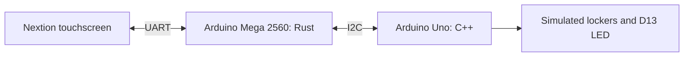
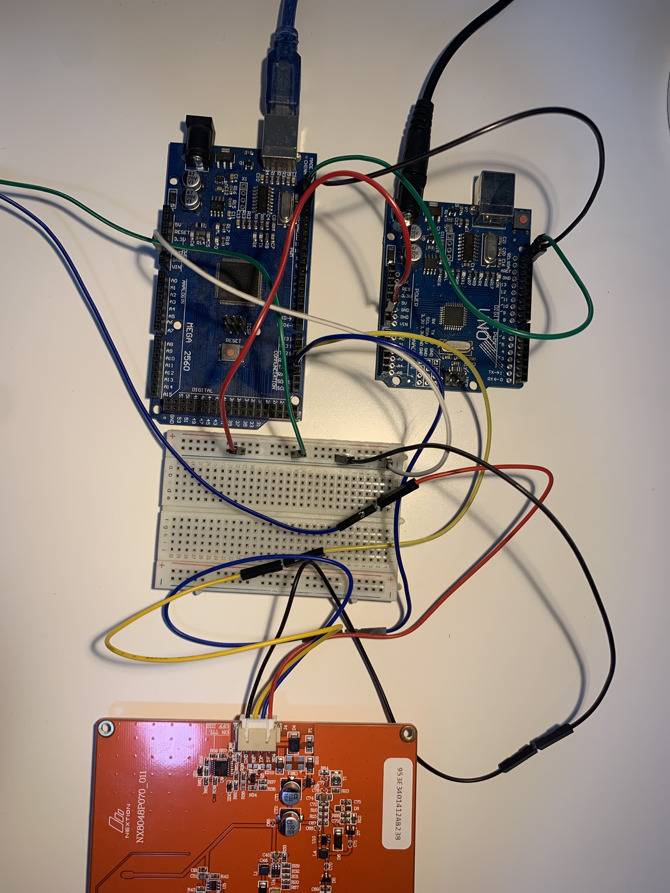
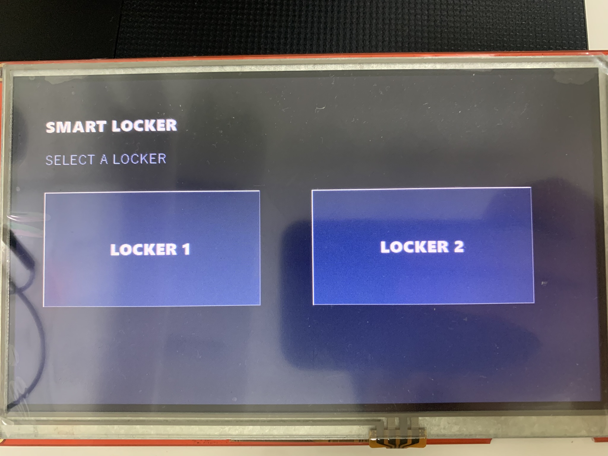
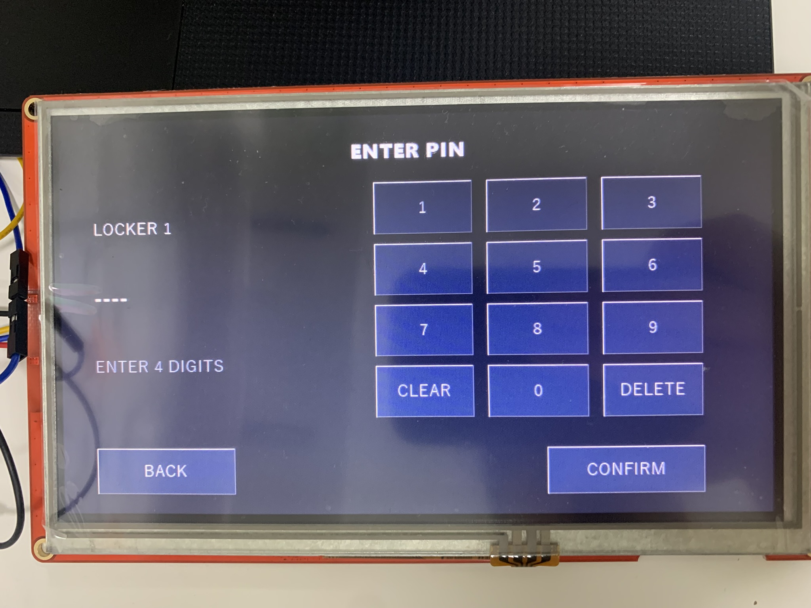
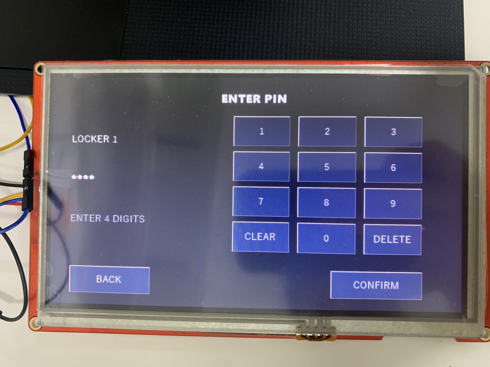
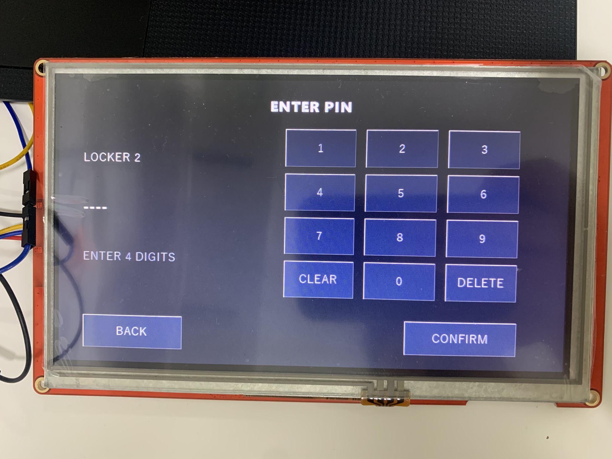
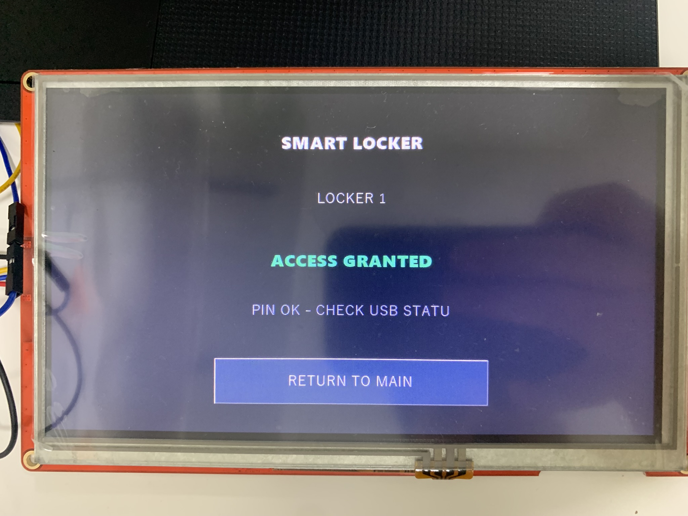
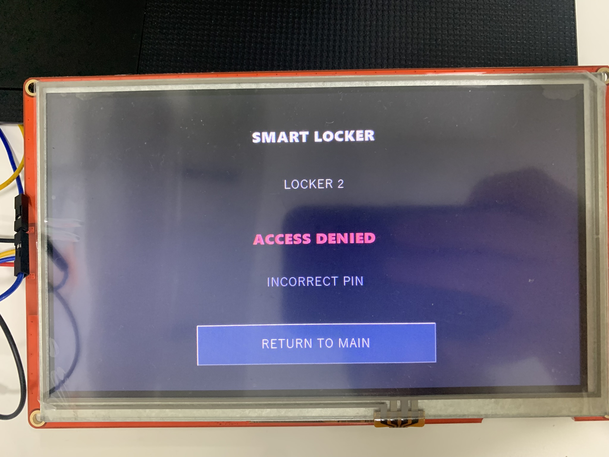

<div align="center">
  <h1>Rust Embedded Smart Locker</h1>
  <p><em>A touchscreen parcel locker prototype built with embedded Rust and Arduino C++</em></p>

  <p>
    
    
    
    
    
    
  </p>
</div>

Rust Embedded Smart Locker is a parcel locker prototype controlled through a Nextion touchscreen. It uses embedded Rust, C++, UART and I2C. The Mega handles the interface and PIN validation, while the Uno manages the states of two simulated lockers.

The project shows how three embedded devices communicate using fixed-size buffers and a small state machine. **There are no physical locks or door sensors.** Software states and the Uno's onboard LED represent locker operation.

## Features

- Three-page Nextion interface: locker selection, masked PIN entry and access result
- PIN validation on the Mega, with clear, delete, back and home actions
- Automatic screen startup after power-on; no computer command needed
- Independent open/closed states for two lockers on the Uno
- USB serial diagnostics and a small I2C request/response protocol
- Rust host tests and C++ controller logic tests

## Architecture



Nextion sends button events to the Mega. The Rust application checks the PIN, requests an operation for the selected locker over I2C, and updates the screen. The Uno keeps the locker states and reports them to the Mega. Its D13 LED is on whenever at least one locker is open.

## Hardware and wiring

| Device | Role |
| --- | --- |
| Arduino Mega 2560 compatible board | Main controller; Rust `no_std` with `avr-hal` |
| Arduino Uno / ATmega328P compatible board | Peripheral controller; C++ with Arduino `Wire` |
| Nextion NX8048P070-011R, 800x480 | Touchscreen interface |

| Mega | Connection |
| --- | --- |
| D18 / TX1 | Nextion RX |
| D19 / RX1 | Nextion TX |
| D20 / SDA | Uno A4 / SDA |
| D21 / SCL | Uno A5 / SCL |
| GND | Uno GND and Nextion supply GND |
| USB | Computer power and optional serial diagnostics |

UART uses **9600 baud, 8N1**. I2C runs at **50 kHz**, with the Uno at address **0x12**.

Power Nextion from a suitable independent 5 V supply and each Arduino through a supported power input. Share GND, but do not join independent 5V/VIN rails. Disconnect power before changing the wiring.

In the test setup, the Mega used USB power and the Uno used a 12 V adapter through its barrel jack.

## Using the demo

1. Power all three devices and wait for the main screen.
2. Select LOCKER 1 or LOCKER 2.
3. Enter the development PIN **`1234`** and tap CONFIRM.
4. Check the access result and the Uno D13 indicator.

An incorrect PIN shows ACCESS DENIED without sending an open request. The public PIN is for demonstration only, not for real access control. ACCESS GRANTED means the PIN was accepted. Read the Uno's simulated state with the USB `STATUS` command.

For optional debugging, open the Mega serial port at 9600 baud and send commands with a line ending:

| Command | Function |
| --- | --- |
| `PING` | Check that the Mega responds; returns `PONG` |
| `STATUS` | Read both locker states from the Uno over I2C |
| `OPEN 1`, `OPEN 2` | Open the selected simulated locker |
| `CLOSE 1`, `CLOSE 2` | Close the selected simulated locker |
| `HMI START` | Manually resynchronize the touchscreen |

The Uno must be connected and powered before locker commands or correct-PIN operations.

## Validation

Screen navigation, masked input, editing, incorrect-PIN rejection and correct-PIN flows for both simulated lockers were verified on real hardware. I2C responses and the Uno LED were checked separately. All 10 command checks passed in the integration run, which finished with both lockers closed.

The later automatic-start update passed 26 Rust tests, AVR compilation, flash verification and USB checks. Automatic navigation after power-on was also physically confirmed.

See the [technical notes](DEVELOPMENT.md), [I2C protocol](firmware/I2C_PROTOCOL.md) and [HMI mapping](nextion/PHASE3B_DESIGN.md) for the toolchain, build commands and validation limits.

## Repository layout

```text
firmware/mega-rust/     Embedded Rust application and UART bridge
firmware/uno-cpp/       C++ simulated-locker peripheral
nextion/               Editable HMI project and fonts
tools/nextion-upload/   Rust serial TFT uploader
```

## Limitations

- No physical locks, relays, motors or door sensors; this is a working prototype.
- The cause of occasional serial corruption at startup is still unknown.
- Incomplete-PIN handling has host test coverage but has not been physically tested.
- I2C stuck-bus recovery, power-loss recovery and long-term reliability are unverified.
- Supply capacity, runtime stack margin and electrical timing have not been measured.

## Demo media

| Content | Status |
| --- | --- |
| Hardware setup photo |  |
| Physical touchscreen photos |  <br> <br>  |

https://github.com/user-attachments/assets/8ea478e8-0b67-485b-8915-85095874101f
